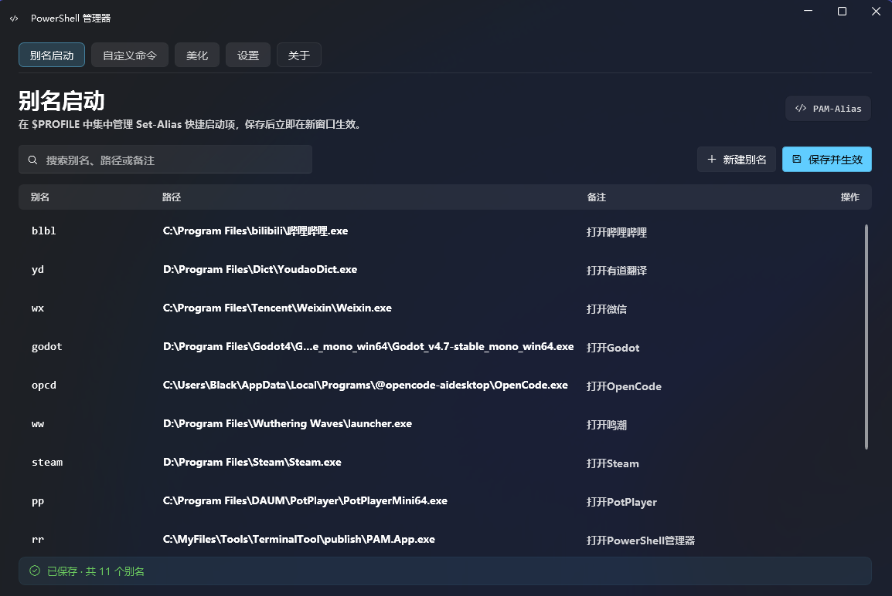
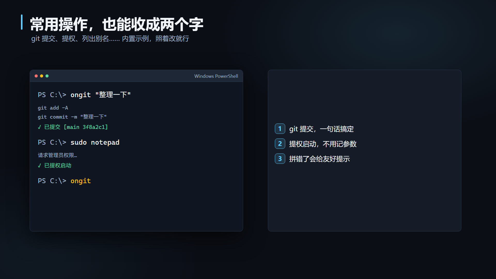

# PowerShell 管理器（PAM）

  

PowerShell 管理器（PAM）是一款 Windows 图形化工具：用界面管理 PowerShell `$PROFILE` 里的别名与自定义命令，配置 Starship 提示符和 Windows Terminal 外观，并用全局热键随时唤起终端。

## 界面预览





## 目录

- [界面预览](#界面预览)
- [功能速览](#功能速览)
- [快速开始](#快速开始)
- [功能说明](#功能说明)
- [工作原理](#工作原理)
- [数据与文件](#数据与文件)
- [常见问题](#常见问题)
- [从源码构建](#从源码构建)
- [发布 Release](#发布-release)
- [隐私](#隐私)
- [反馈与贡献](#反馈与贡献)
- [许可证](#许可证)

## 功能速览

| 你在界面里做的事                | 终端里得到的效果                       |
| ----------------------- | ------------------------------ |
| 添加一条别名 `blbl` 指向某个 exe  | 输入 `blbl` 直接启动程序，可附带固定启动参数     |
| 添加一条自定义命令 `gst`         | 输入 `gst` 执行一段自己的 PowerShell 代码 |
| 选一个 Starship 主题，或自己写提示符 | 新终端里就有好看的提示符                   |
| 调整字体、透明度、背景图            | Windows Terminal 外观随之变化        |
| 按下 `Ctrl+Alt+T`         | 立刻唤起同一个 Windows Terminal 窗口    |

此外还有：亮 / 暗主题与中英双语、开机自启、关闭主窗口后托盘继续驻留、终端输入自动切英文、失焦自动隐藏、未知命令友好提示，以及配置备份与一键恢复。

## 快速开始

### 环境要求

| 必需                         | 说明                     |
| -------------------------- | ---------------------- |
| Windows 10 / 11            | —                      |
| Windows PowerShell 5.1     | 系统自带                   |
| Windows Terminal（`wt.exe`） | 热键唤醒与窗口效果依赖它           |

从 Releases 下载的安装包已内置 .NET 10 桌面运行时，无需另外安装；只有从源码运行 / 构建才需要 .NET 10 SDK。

可选：PowerShell 7（未安装时自动回退 5.1 并在设置页提示）；Starship 与 Scoop（美化页提供一键安装）；Nerd Font（内置 Cascadia Code NF 可一键安装）。

### 安装

从 [Releases](https://github.com/ls6985/PAM/releases) 下载 `PAM-Setup-*.exe`，双击安装：不需要管理员权限，也不需要预装 .NET 运行时，默认装到 `%LOCALAPPDATA%\Programs\PAM`，完成后从开始菜单打开「PowerShell 管理器」。

不需要单独的卸载程序：装好之后，Windows「设置 → 应用 → 已安装的应用」和开始菜单里都会出现「卸载 PowerShell 管理器」。

卸载：在「设置 → 应用 → 已安装的应用」或开始菜单选择「卸载 PowerShell 管理器」。卸载会结束运行中的实例、移除登录启动项，并清掉两份 `$PROFILE` 里的 PAM 托管区（原文件自动备份）；卸载时可以选择是否把 `%AppData%\PAM` 里的别名与设置改名留存。Windows Terminal 外观、Starship 配置和已安装的字体属于独立改动，卸载不会还原，可先在美化页用备份恢复。

### 第一次使用

1. 打开 `PAM.App.exe`，在「别名启动」页加一条常用程序，点保存。
2. **新开一个终端窗口**。`$PROFILE` 只在终端启动时读取一次，已经开着的窗口不会自动更新。
3. 输入别名试一下；再按 `Ctrl+Alt+T`（默认热键）体验随时唤起终端。

编辑时可用 `Ctrl+N` 新建、`Ctrl+S` 保存、`Enter` 确认、`Esc` 取消；自定义命令的多行编辑条用 `Ctrl+Enter` 确认。

## 功能说明

### 五个页签

| 页签    | 用途                                                    |
| ----- | ----------------------------------------------------- |
| 别名启动  | 搜索 / 新建 / 改名 / 删除别名，浏览程序路径，设置每次启动固定附带的参数              |
| 自定义命令 | 用命令名 + 命令体定义自己的命令，可随时启用 / 停用；「示例 / 指南」里有六条可复制的示例      |
| 美化    | Starship 主题预设 / 自定义提示符、字体安装、Windows Terminal 外观、备份与恢复 |
| 设置    | 主题、语言、默认终端、全局热键、开机自启、托盘与终端输入相关开关                      |
| 关于    | 版本信息与更新检测、内置帮助文档、问题反馈、开源许可与赞助入口                     |

### 别名启动

- 填别名、程序路径、备注（可选）即可新建；过长的路径会中间省略显示，路径失效时列表会给出提示。
- 启动默认借 `explorer.exe` 脱离终端进程树：关闭终端不影响被启动的程序，日志不回显，UAC 提权正常。
- 「高级选项：启动参数」可配置每次启动固定附带的参数，排在你在终端里临时传入的参数之前。
- 设置页还有四个相关开关：脱离进程树启动、启动前打印备注、未知命令友好提示、敲下别名回车后立即隐藏终端窗口（窗口不关闭、会话不结束，按热键可唤回同一个会话）。
- `pls` / `ongit` / `sudo` 是内置命令名，不能用作别名或自定义命令名。

### 自定义命令

命令名就是终端里的调用入口，只写要执行的命令体，程序会自动包成同名函数。例如命令名 `gst`、代码 `git status`，保存后输入 `gst` 即可。列表里的状态胶囊点击即可切换启用 / 停用；编辑条里的「高级选项：命令参数」可以开启「允许在命令名后传入参数」并填写固定参数。

内置命令随每次保存自动维护，只读展示、不可编辑或停用：

| 命令                       | 行为                               |
| ------------------------ | -------------------------------- |
| `pls`                    | 列出全部别名及路径、备注                     |
| `ongit <信息>`             | `git add -A` 后 `git commit -m`   |
| `sudo [-w] <程序/别名> [参数]` | 提权运行，支持 exe、路径与 PAM 别名；`-w` 等待结束 |

### 终端美化

- **Starship 主题**：六个内置预设，或自己写自定义提示符片段；两者显式二选一，不会叠加。
- **字体**：一键安装内置 Cascadia Code NF，避免提示符图标显示成方块。
- **终端外观**：Windows Terminal 的字体、复古效果、光标、背景图、透明度等写入 `profiles.defaults`，只提交有改动的项。
- **备份**：`starship.toml` 在应用前备份为 `.bak`（最近一次，恢复后保留）；Windows Terminal 的 `settings.json` 在首次修改前备份为 `settings.json.bak`（永不覆盖，可反复恢复）。
- 「通用设置」里的「提示符前空一行」「路径分隔符用 /」对两种提示符方案都生效；底部「恢复默认」「放弃更改」「保存设置」也由两者共用。

### 设置与托盘

- 亮 / 暗 / 跟随系统；简体中文 / English 立即生效。
- 默认终端 `pwsh` / `powershell` / `auto`，只决定热键唤醒哪个 shell；别名与命令在两个版本里都可用。
- 全局热键默认 `Ctrl+Alt+T`，可修改；应用前会检查系统保留组合、真实占用与常见软件冲突。托盘长期持有同一个 Windows Terminal 窗口，按热键只做显示 + 置前，不会重复开窗口。
- 开机自启默认开启（写 HKCU `Run` 项）；程序目录移动后，打开一次主界面即自动校准路径。
- 关闭主窗口后托盘与热键默认保留，可在设置页查看 / 启动 / 结束托盘。
- 「失去焦点时隐藏终端窗口」使用 Windows Terminal 原生行为；「终端预热」可让托盘提前备好一个隐藏窗口，缩短首次唤醒的时间。

## 工作原理

PAM 把 `$PROFILE` 分成两段：`# >>> PAM Managed >>>` 标记之前是你自己的内容，逐行原样保留；之后是托管区，每次保存按数据全量重写。别名包装函数、自定义命令、Starship 初始化、未知命令提示都在这里生成。

- 托管区按同一份数据分别写入 **PowerShell 7** 与 **Windows PowerShell 5.1** 的 `$PROFILE`（已安装的版本各一份），内容一致，因此换终端也能用。
- 文件以 **UTF-8 BOM** 写入，保证 Windows PowerShell 5.1 正确解析含中文的内容。
- 用户区已有同名 alias / function 时包装函数会让位，并在保存后提示冲突，不会删掉你自己写的东西。
- 设置里的运行时开关由托管区在终端启动时读取，改设置即时生效；但 `$PROFILE` 本身只在终端启动时加载一次，**改完别名、命令、美化都要新开终端窗口**。

主界面 `PAM.App` 是配置的唯一写入方，后台托盘 `PAM.Tray` 只读配置、负责全局热键；两者通过命名事件与文件时间戳同步，互不直接引用。

## 数据与文件

所有数据都在本机：

| 数据             | 位置                                                                      |
| -------------- | ----------------------------------------------------------------------- |
| 别名与自定义命令       | `%AppData%\PAM\pam-data.json`                                           |
| 主题、语言、热键等设置    | `%AppData%\PAM\settings.json`                                           |
| `$PROFILE` 托管区 | `Documents\PowerShell\` 与 `Documents\WindowsPowerShell\` 各自的 profile 文件 |
| Starship 主题    | `~\.config\starship.toml`（另有 `.bak` 备份）                                 |
| 终端外观           | Windows Terminal 的 `settings.json`（另有 `settings.json.bak` 备份）           |
| 输入法切换日志        | `%AppData%\PAM\ime-switch.log`                                          |

配置文件损坏时程序会回退到空数据 / 默认值，不会打不开。手工编辑 `settings.json` 同样会生效（托盘有文件时间戳轮询兜底）。

## 常见问题

| 现象       | 处理                                                                  |
| -------- | ------------------------------------------------------------------- |
| 改了不生效    | 新开一个终端窗口；已开着的窗口不会自动刷新 `$PROFILE`                                    |
| 提示执行策略受限 | 用别名页或设置页的「尝试修复」                                                     |
| 别名启动失败   | 检查程序路径是否还存在（列表会有提示），再确认新开了终端窗口                                      |
| 提示符图标是方块 | 在美化页安装内置 Cascadia Code NF 字体后重开终端                                   |
| 热键没反应    | 在设置页查看托盘是否运行，或换个组合键（可能被其他软件占用）                                      |
| 想彻底清理    | 删除 `%AppData%\PAM`、`$PROFILE` 两个标记之间的托管区，以及需要的美化备份；标记之外自写的内容不会被程序改动 |

## 从源码构建

改完代码想直接试，不用装一遍：

```powershell
powershell -ExecutionPolicy Bypass -File .\publish.ps1    # 产出 output\publish\，双击 PAM.App.exe 就能测
```

要出安装包再跑：

```powershell
dotnet run --project PAM.App                                                 # 开发运行：主界面 + 后台托盘
dotnet test                                                                  # 运行 PAM.Core 单元测试
powershell -ExecutionPolicy Bypass -File .\build\build-installer.ps1       # 产出 output\export\ 里的安装程序
```

所有生成物都在 `output/` 下（整目录已被 git 忽略）：

| 目录 | 内容 |
| --- | --- |
| `output\publish\` | 本地测试用的散装程序 |
| `output\installer\` | 内置 .NET 运行时的完整程序文件，给安装包打包用 |
| `output\export\` | `PAM-Setup-<版本>.exe`，唯一要上传 Release 的成品 |
| `output\promo\` | 宣传片工程 |

`build\build-installer.ps1` 是发布入口：先把程序发布到 `output\installer`，再用 Inno Setup 编译成安装包。需要先装一次编译器：`winget install --id JRSoftware.InnoSetup -e --source winget`。`publish.ps1` 默认发布到 `output\publish`，加 `-SelfContained` 可发布内置运行时的版本。`PAM.App.exe` 与 `PAM.Tray.exe` 必须保持同目录：主界面会自动拉起同目录的托盘程序，托盘的右键菜单也要靠同目录的主界面 exe 打开。

| 工程          | 职责                                                     |
| ----------- | ------------------------------------------------------ |
| `PAM.Core`  | 无 UI 的核心库：数据模型与配置读写、`$PROFILE` 渲染、Starship 与终端外观服务、本地化 |
| `PAM.App`   | WPF 主界面，用户唯一入口，也是配置的唯一写入方                              |
| `PAM.Tray`  | 后台托盘：全局热键、唤醒 Windows Terminal、输入法切换                    |
| `PAM.Tests` | xUnit 测试，覆盖 `PAM.Core` 的纯逻辑                            |

技术栈：.NET 10（`net10.0-windows`）、WPF + [WPF-UI](https://github.com/lepoco/wpfui) 4.3.0、WinForms 托盘、Newtonsoft.Json（用于 Windows Terminal `settings.json` 的 JSONC 精准拼接）。App / Tray 都只引用 `PAM.Core`，互不引用。

## 发布 Release

一句话：**提交 → 推送 → 打标签 → 推送标签**，剩下的 GitHub 会自己做。

版本号写在 `PAM.App.csproj` 与 `PAM.Tray.csproj` 的 `<Version>` 里，两处必须一致；标签名就是 `v` + 这个版本号（当前是 `v1.0.0`）。关于页的更新检测读的是最新正式版 Release 的标签，所以别把它标成预发布。

用 Sourcetree 发布：

1. 改好两个 csproj 的版本号，在「文件状态」里提交（Commit）全部改动，点「推送」（Push）到 `main`。
2. 在最新的那次提交上右键 → 「标签」（Tag），名称填 `v1.0.0`，**勾选「推送标签」**，确定。
3. GitHub Actions 会自动在云端跑完单元测试、编译安装程序、创建 Release 并上传 `PAM-Setup-1.0.0.exe`。等仓库的 Actions 页面变绿即可。

测试是在云端跑的，本机不用跑；跑不过会显示红叉，也不会生成 Release。想在本机自己确认一次，执行 `dotnet test` 即可。命令行等价写法：

```powershell
git add -A
git commit -m "release: v1.0.0"
git push origin main
git tag v1.0.0
git push origin v1.0.0
```

也可以完全不走自动流程：在 GitHub 网页打开 Releases → 「Draft a new release」→ 选好标签 → 把本地 `output/export/PAM-Setup-1.0.0.exe` 拖进上传区 → 「Publish release」。GitHub 会自动附上该标签的源码压缩包，所以 Release 里只需要这一个 exe。两种方式选一种，别同时用，否则会出现两个 Release。需要重发时也可以在 Actions 页面手动触发工作流并填入已有标签。

首次下载未签名的 exe 时 Windows 可能给出 SmartScreen 提示，选择「更多信息 → 仍要运行」即可；要消除提示需要代码签名证书。

## 隐私

本地运行、开源免费，不收集任何数据。程序不会向服务器发送你的别名、命令、路径或输入内容；只有你主动点击「一键安装 Starship（含 Scoop）」这类操作时才会联网下载对应组件。只想重置设置，可用设置页的「恢复默认」，别名与命令数据会保留。

## 反馈与贡献

欢迎通过 [Issues](https://github.com/ls6985/PAM/issues) 反馈问题或建议，也欢迎提 PR。改动 `PAM.Core` 的逻辑后请跑一遍 `dotnet test`；涉及 `$PROFILE` 托管区格式或配置字段时，请同步更新对应的测试断言。

## 许可证

[MIT](LICENSE) © 2026 white
